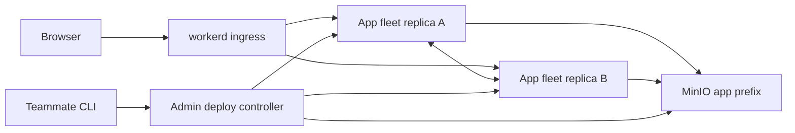

# Architecture

fogd runs complete Void applications on celld and uses workerd as HTTP ingress.
The source audit is in [compat.md](compat.md); the original proposal and review
responses remain in [reviews](reviews/architecture-proposal.md).

## Container view

Each app owns a stable bucket prefix, script name, resource identity map, and two
replicas. A replica has its own persistent log volume. Two apps require four celld
containers in one local stack. Later, each of two machines hosts one replica of
each app. Bucket endpoints and peer advertised addresses are configuration values.
MinIO is a single local durability dependency, not a highly available cluster.

Each fleet needs a private network. Only public worker listeners are ingress
backends; operator listeners stay unpublished. Replicas necessarily hold bucket
credentials. The controller holds provisioning credentials; app builds and teammate
clients receive neither. Prefix naming alone does not enforce storage isolation:
credentials should be scoped per fleet before deployments cross trust boundaries.

## Component view: request and binding ownership

workerd forwards HTTP requests to a healthy celld replica. A preflight health check
reduces traffic to dead replicas but cannot prove a later write succeeds. An
ambiguous write is never transparently retried. Application retries require durable
deduplication in the same transaction as the mutation, not just an idempotency header.

The worker, D1 client/backend, R2 binding/backend, and Durable Object code execute
inside celld. celld routes object operations between nodes and owns leases,
replication, and bucket persistence. workerd's external HTTP service binding carries
requests and responses. No binding instance, RPC stub, transaction, AbortSignal,
or Durable Object identity crosses the workerd/celld boundary.

Ingress blocks Void's internal migration/proxy paths and removes privileged
headers. Stream and WebSocket behavior must be verified separately. R2 multipart
handles cannot survive node changes, so v0 examples use ordinary object puts/gets.

## Component view: deployment gates

1. Build with Vite locally, with remote bindings disabled and no runtime credentials.
2. Stage the worker modules, assets, exact application SQL list, and validated config.
   Reject unsupported bindings/flags, auth-managed migrations, unsafe paths, and
   resource identity changes. Exclude `seed.sql` and preserve migration order.
3. Record an immutable content digest. Platform v0 requires an admin to approve
   that exact artifact before any celld publication, migration, or background work.
4. Serialize publication and pause routing durably. For an existing app, apply
   SQL against its current D1 before publishing the new worker. For a new app,
   bootstrap its worker privately, apply SQL, then enable routing. Background
   consumers are excluded from the initial deployment adapter until this sequence
   can safely gate them.
5. Verify both replicas adopted the expected release, independently of their boolean
   health, before reporting success. Failed adoption must not be mistaken for a
   successful old-generation health check.

celld is the authoritative SQL migration runner, using its own ledger. Moving an
existing Cloudflare database with a Void migration ledger requires an explicit
baseline operation outside v0. Neither runtime publication nor migrations are an
atomic transaction across replicas. Schema rollback is not automatic.

## Scope and operational constraints

v0 runs trusted, admin-approved application code. celld does not claim hostile tenant
isolation; approval is a deployment authorization boundary. An app can reach its own
process's internal interfaces. Separate fleet networks reduce cross-app exposure,
but do not fix that upstream trust model. Do not expose an untrusted public PaaS.

Container CPU/memory limits and celld heap/resident-cell limits bound resources where
available. They do not provide Cloudflare's complete per-request CPU accounting.
Persistent replica volumes and restart supervision are required for recovery. A
bucket conditional-write and ranged-read probe must pass before accepting the
local storage backend. MinIO is qualified here only by the recorded local tests.

The local stack uses HTTP on loopback. Homelab deployment needs ingress TLS and an
encrypted private peer network; workerd can terminate TLS with supplied certificates,
but fogd v0 does not provision certificates or DNS. Void Platform's Postgres, OAuth,
analytics, billing, and Cloudflare resource provisioning are not required by this
architecture. The implemented approval controller is described in [platform.md](platform.md).
